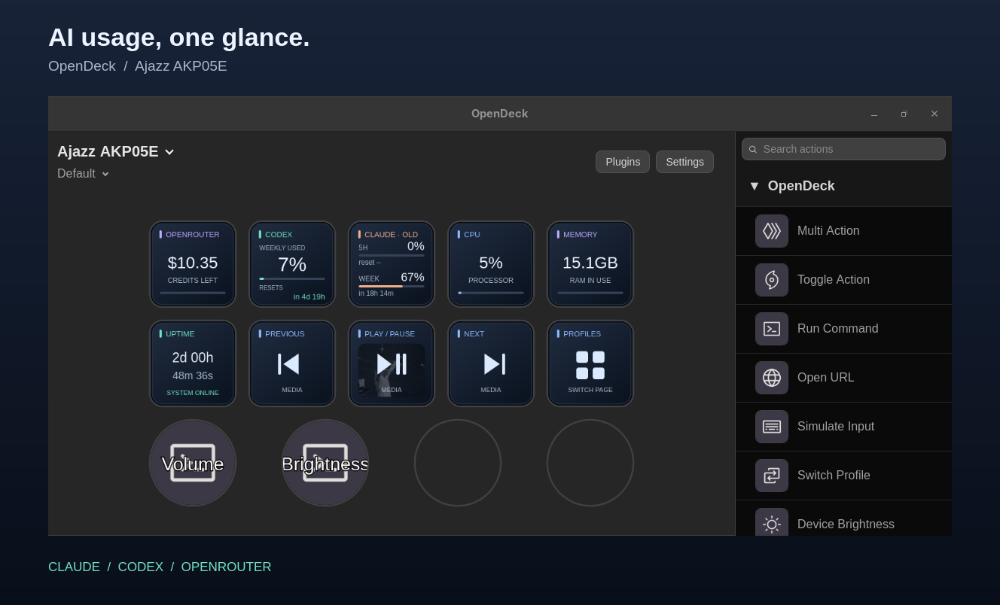

# OpenDeck AI Usage

**Claude and Codex quotas, OpenRouter credits — at a glance on your deck.**

A Linux plugin collection for **[OpenDeck](https://github.com/nekename/OpenDeck)**, with matching dark cards, usage bars and reset countdowns. Built and tested on the **Ajazz AKP05E** (10 display keys and 4 dials).

> **You need OpenDeck AND the device-support plugin.** This repository is not standalone deck software and does not include a hardware driver. For the Ajazz AKP05E, install **[Ajazz AKP05 / Mirabox N4](https://github.com/ambiso/opendeck-akp05)** in OpenDeck first. See the steps below.



*Actual OpenDeck profile screenshot, cropped and framed; the usage values are not mock data. `OLD` on the Claude card indicates a retained reading that has not been successfully revalidated. Your numbers will differ. System/media/dial actions come from separate plugins and are not installed or assigned by this collection.*

## What it shows

| Card | Meaning | Provided by |
| --- | --- | --- |
| **Claude** | Five-hour and weekly quota **used**, plus time until reset | This repo |
| **Codex** | ChatGPT-plan quota **used**, plus time until reset; weekly-only accounts get a larger weekly card | This repo |
| **OpenRouter** | Remaining account credits in USD, **not** a subscription quota or per-key spending limit | [OpenRouter Credits by ImDevinC](https://github.com/ImDevinC/opendeck-openrouter-usage), installed separately |

Claude also includes an optional **Monthly extra allowance** action: monthly extra-usage spending cap minus spending, not prepaid wallet balance. It is not on the screenshot's main usage card.

## Requirements

- **Native Linux OpenDeck 2.5.0 or newer.** Tested on x86-64 Linux. ARM64 source builds are supported by the installer but untested. Windows, macOS and sandboxed Flatpak installs are **not currently supported by this collection**, even though OpenDeck itself supports them.
- **Ajazz AKP05E**: USB vendor/product **`0300:3004`**, supported by the separate **Ajazz AKP05 / Mirabox N4** plugin. The similarly named AKP05 is a different model; choose the driver linked here, not just one with a similar name.
- Rust stable, a C compiler/linker, Python **3.11+**, and `pgrep` (procps/procps-ng). Linux filesystem user xattrs are needed for Claude token renewal.
- Authenticated **Claude Code** and/or **Codex CLI**, accessible to the same Linux user as OpenDeck. `python3`, `claude` and `codex` must be on **OpenDeck's PATH**, not only in an interactive shell.
- An **OpenRouter management API key** if you want the OpenRouter card. A regular inference key does not work with the upstream credits endpoint.

The Claude/Codex actions do not depend on a particular device serial. The optional style bridge applies to **N4-family devices on a profile named `Default`**.

## Quick setup — one command

On **native x86-64 Linux**, install OpenDeck 2.5+, Git, Python 3.11+, Rust stable and a C compiler first. Then run as your normal desktop user (**not with sudo**):

```sh
bash <(curl -fsSL https://raw.githubusercontent.com/deestax/opendeck-ai-usage/main/setup.sh)
```

Prefer to inspect the code first? Clone this repository, read [`setup.sh`](setup.sh) and [`scripts/setup.py`](scripts/setup.py), then run `bash setup.sh`. The remote command downloads a fresh checkout; it never resets an existing checkout. It requires Bash and curl in addition to the build prerequisites.

The guided setup:

1. Checks prerequisites and asks you to quit OpenDeck; never kills it.
2. Shows the plan and asks before installing or replacing existing Claude/Codex plugins.
3. Downloads **missing** Ajazz AKP05 / Mirabox N4 and OpenRouter Credits plugins from pinned upstream releases and verifies their SHA-256 checksums. Existing upstream versions are kept.
4. Builds Claude/Codex and the shared renderer using `cargo --locked`.
5. Stages the complete plugin installation, creates private backups, then installs it. Failed plugin-folder swaps are rolled back.
6. Applies matching styling to the OpenRouter card and any installed System Information / Linux Media plugins. Reruns update this setup's managed style wrapper without nesting wrappers.

**One command installs the plugins, not your personal accounts.** You still sign in to Claude/Codex, add the three actions to your OpenDeck profile, and enter your own OpenRouter **management** key. The script never requests keys, reads login files, changes key assignments/dials, or buys anything. It does not install OpenDeck, OS packages, Rust, or the account CLIs for you; missing prerequisites produce installation guidance.

### Useful options

From a checkout:

```sh
bash setup.sh --dry-run                    # Check and preview; no build/install
bash setup.sh --install-udev               # Also authorize Ajazz rules via sudo
bash setup.sh --no-style                   # Keep upstream card rendering
bash setup.sh --yes --replace              # Unattended user-level install/update
bash setup.sh --plugins-dir /custom/opendeck/plugins
```

For remote setup, append these options after the process substitution, e.g.:

```sh
bash <(curl -fsSL https://raw.githubusercontent.com/deestax/opendeck-ai-usage/main/setup.sh) --install-udev
```

**Ajazz udev permissions are still required.** `--install-udev` separately authorizes installing the checksum-verified rules into `/etc/udev/rules.d/` and reloading udev. Existing rules are backed up before replacement. Without that flag there are no privileged changes; follow the driver's instructions if the deck isn't detected. Unplug/reconnect after installing the rules. `--yes` does **not** imply `--replace` or `--install-udev`.

`--dry-run` does not build or download third-party dependencies; the remote bootstrap still downloads this repository. It checks local prerequisites, so missing tools can stop even a dry run. Local `bash setup.sh --help` needs no prerequisites.

Setup backups live under `$XDG_STATE_HOME/opendeck-ai-usage/setup-*` (normally `~/.local/state/`). **They can contain private plugin settings: do not share them.** The receipt lists affected folders. To undo an installation, quit OpenDeck, review intervening changes, and restore the relevant backed-up folders; newly installed plugins have no earlier folder to restore. The setup never upgrades existing upstream plugin releases automatically. Unknown/legacy style wrappers are rejected rather than overwritten; use `--no-style` or first restore the original upstream manifest.

Flatpak, macOS, Windows and ARM64 are not supported by guided setup. ARM64 users can use the manual source-build path below for Claude/Codex, with an appropriate separately installed hardware driver.

## Manual setup

### 1. Install OpenDeck and the Ajazz hardware plugin

1. Install [OpenDeck](https://github.com/nekename/OpenDeck#installation).
2. Download the device plugin archive from [ambiso/opendeck-akp05 releases](https://github.com/ambiso/opendeck-akp05/releases).
3. In OpenDeck, choose **Plugins → Install from file** and select that archive.
4. Follow the driver's [Linux udev instructions](https://github.com/ambiso/opendeck-akp05#installation): install its [`40-opendeck-akp05.rules`](https://github.com/ambiso/opendeck-akp05/blob/main/40-opendeck-akp05.rules) in `/etc/udev/rules.d/`, then run `sudo udevadm control --reload-rules`.
5. Unplug/reconnect the deck and restart OpenDeck. Confirm **Ajazz AKP05E** appears in the device selector before proceeding.

**These are two separate installations:** the Ajazz plugin connects the hardware; the usage plugins below supply the buttons.

### 2. Sign in to your own accounts

- Sign in through Claude Code normally (`claude auth login`). The plugin uses the Linux credentials file at `~/.claude/.credentials.json`, respecting `CLAUDE_SECURESTORAGE_CONFIG_DIR` / `CLAUDE_CONFIG_DIR`.
- Run `codex login` using a **ChatGPT subscription account**. API-key-only Codex accounts may not expose these quota windows.
- For OpenRouter, install [OpenRouter Credits](https://github.com/ImDevinC/opendeck-openrouter-usage) using its releases or documented `make install` procedure. Add **OpenRouter → Credits**, select the key, and enter **your own management API key** in its property inspector.

**Never share your OpenDeck profile exports without inspecting them:** the upstream OpenRouter plugin stores its key in action settings. No credentials, exported profiles or account backups are included here.

### 3. Build and install Claude + Codex

```sh
git clone https://github.com/deestax/opendeck-ai-usage.git
cd opendeck-ai-usage
cargo build --release --workspace --locked

# Validate first — does not write anything:
python3 scripts/install.py --dry-run

# Quit OpenDeck from its tray menu, then:
python3 scripts/install.py
```

The installer uses `$XDG_CONFIG_HOME/opendeck/plugins` (default `~/.config/opendeck/plugins`). It does not edit profiles, assign keys, install third-party plugins, or touch logins. It refuses to overwrite an existing Claude/Codex installation unless you pass **`--replace`**; replacements are backed up first. For a nonstandard native config location, pass `--plugins-dir /path/to/opendeck/plugins`.

Alternatively, run `python3 scripts/package.py` after building and install the two `dist/*.sdPlugin.zip` archives through **Plugins → Install from file**. These binaries target the Linux architecture on which you built them; they are not cross-platform archives.

Restart OpenDeck, then drag these actions onto keys:

- **Claude → Usage and resets**
- **Codex → Usage**
- **OpenRouter → Credits** (from the separate upstream plugin)

### 4. Optional: match the screenshot's styling

Claude and Codex already use the shared card style. To also restyle the existing upstream OpenRouter card (plus System Information and Linux Media if installed), quit OpenDeck and run:

```sh
python3 scripts/install.py --replace --style --dry-run
python3 scripts/install.py --replace --style
```

This backs up affected plugin folders and wraps their display output; original vendor executables, settings, requests and button behavior stay unchanged. No profile is edited. Styling applies only to a profile named **`Default`** on N4-family devices, regardless of serial number. Other profiles pass through unchanged.

Arrange your keys as desired. The screenshot uses:

```text
OpenRouter   Codex       Claude       CPU          RAM
Uptime       Previous   Play/Pause   Next         Profiles
```

CPU/RAM/uptime come from **System Information**; playback actions from **Linux Media**; profile switching from OpenDeck's starter pack. Install those separately if wanted. A matching optional profile-switch image is provided at [`opendeck-style/assets/9.svg`](opendeck-style/assets/9.svg); choose it manually in that key's image editor. Dial setup is independent and not included.

Plugin updates can replace wrapper manifest entries. After an upstream update, check the display before reapplying styling. The installer safely updates its own recorded style wrappers, but refuses unknown/legacy wrappers. For rollback, quit OpenDeck, inspect the private backup path printed by installation, and restore only the affected manifests after checking for newer upstream changes. Do not blindly overwrite an edited profile or a newer plugin with an old backup.

## Refreshing and troubleshooting

- **Normal refresh:** Claude/Codex fetch about every 5 minutes while visible. Countdown images redraw every 30 seconds without new provider requests. Tapping retries with a 30-second minimum; error/rate-limit backoff still applies. The upstream OpenRouter plugin has its own schedule.
- **`OLD`:** last successful reading retained after a fetch failure, or a persisted Claude reading awaiting startup revalidation. It is not claimed to be current.
- **`reset --` / `reset due`:** reset time is missing, or the last reported time has elapsed. No new reset window is invented.
- **Claude rate limited:** backoff starts at 15 minutes and escalates for consecutive 429s, respecting numeric `Retry-After`. Restarting or tapping does not bypass it.
- **Claude `Auth helper update needed`:** automatic renewal is deliberately restricted to the reviewed **Claude Code Linux 2.1.289 binary digest**. The helper finds `claude` on PATH, then verifies its SHA-256. Other versions/builds cannot automatically renew through this helper. Sign in/renew through Claude Code itself; already-valid tokens still work. **Do not simply replace the digest to bypass this check.** See [authentication details](docs/authentication.md).
- **Claude unavailable / sign-in required:** check your own CLI login and that the credentials file is owned by you, is a regular non-symlink file and has mode `0600`. No API-key fallback is provided.
- **Codex unavailable:** check `codex login status`, the subscription login, CLI app-server support and OpenDeck's PATH. Missing quota data is shown as unavailable, not zero.
- **Deck absent:** resolve the Ajazz device plugin and udev permissions first; usage actions cannot fix hardware access.

## Development

```sh
cargo test --workspace --locked
cargo clippy --workspace --all-targets --locked -- -D warnings
python3 -m unittest discover -s opendeck-claude-usage/tests -v
python3 -m unittest discover -s tests -v
cargo build --release --workspace --locked
cargo run --locked -p opendeck-style --example bridge_smoke
python3 scripts/package.py
```

Tests use fixtures/mocks and do not require accounts or make provider calls. The bridge smoke test uses local WebSockets. The plugins' `--check` modes are **live diagnostics**, not unit tests: Claude can renew credentials; Codex invokes your signed-in CLI.

Source layout: `opendeck-claude-usage/`, `opendeck-codex-usage/`, and `opendeck-style/` (shared SVG renderer + optional display bridge). Existing `local.superdao.*` action IDs are retained for compatibility with earlier local installs.

## Privacy, attribution and license

No analytics or telemetry is added by this collection. Claude usage requests and optional token renewal go directly to fixed Anthropic HTTPS endpoints; Codex uses its local CLI app-server. The bridge only proxies localhost display messages and never logs message contents. Credentials are not bundled or placed in command arguments. Claude's usage endpoint is **undocumented** and may change.

This repository does **not** bundle or claim authorship of OpenDeck, the Ajazz driver, or the OpenRouter Credits plugin. Thanks to [OpenDeck / OpenAction](https://github.com/nekename/OpenDeck), [ambiso](https://github.com/ambiso/opendeck-akp05), and [ImDevinC](https://github.com/ImDevinC/opendeck-openrouter-usage). Install those projects separately under their respective licenses.

[MIT](LICENSE). Independent community project; not affiliated with Anthropic, OpenAI, OpenRouter or Ajazz.
